<p align="center">
  <a href="https://fondpeace.com/" target="_blank" rel="noopener noreferrer">
    
  </a>
</p>

<p align="center">
  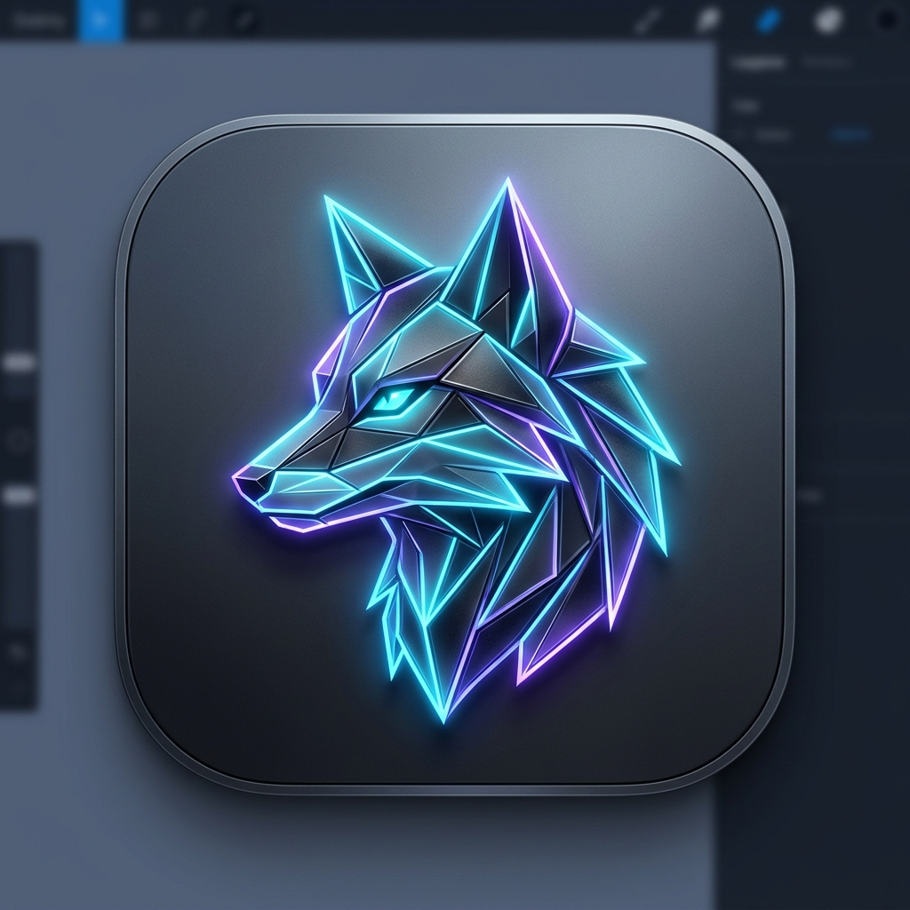
</p>

<h1 align="center">FigCraft Studio</h1>

<p align="center">
  <b>Interface design and prototyping: open source, collaborative, and built in pure Rust.</b><br>
  Frames, auto layout, components and variants, vector networks, styles, variables and prototypes,<br>
  in a native app that opens instantly and works offline. 100% offline, zero cloud dependency, and yours.
</p>

<p align="center">
  
  
  
  
  
  
</p>

<p align="center">
  <a href="https://fondpeace.com/"><b>FondPeace.com</b></a> ·
  <a href="https://fondpeace.com/">Developer & AI Tools</a> ·
  <a href="#-the-fondpeace-creative-ecosystem">FondPeace Ecosystem</a> ·
  <a href="#a-look-around">A look around</a> ·
  <a href="#made-in-figcraft">Made in FigCraft</a> ·
  <a href="#features">Features</a> ·
  <a href="#built-for-agents">Agents (MCP)</a> ·
  <a href="#monorepo-workspace-architecture">Architecture</a> ·
  <a href="#get-started">Get started</a>
</p>

<br>

<p align="center">
  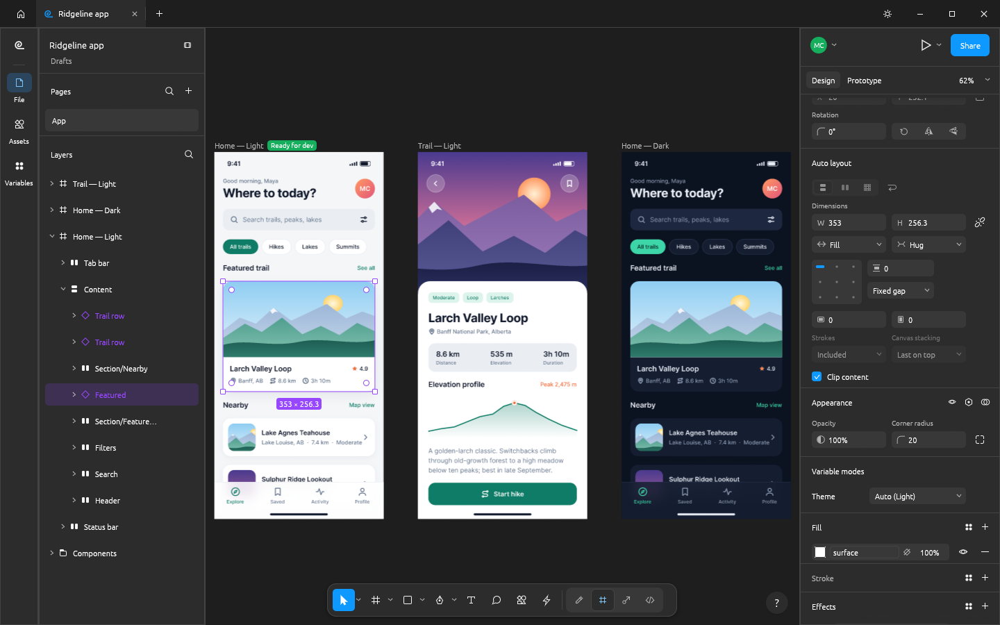
  <br><sub><b>Ridgeline</b>: auto layout screens built from components, with Light and Dark modes from one set of colour variables · <code>official-samples/ridgeline-app.figcraft</code></sub>
</p>

<br>

> [!NOTE]
> **An Open-Source Initiative by [FondPeace.com](https://fondpeace.com/).**
> FigCraft Studio is proudly nurtured under the **FondPeace** digital ecosystem — advancing next-generation creator tools, open-source AI workflows, and offline-first developer software. Visit **[fondpeace.com](https://fondpeace.com/)** to discover trending developer projects, open-source toolkits, and creator insights.

<br>

<table>
  <tr>
    <td width="25%" valign="top">
      <h3>🎛️ Familiar by design</h3>
      The toolbar, layers panel, Design inspector, code connect, menus and shortcuts sit right where your hands expect them. Zero learning curve for modern interface designers.
    </td>
    <td width="25%" valign="top">
      <h3>⚡ Native and fast</h3>
      A pure-Rust engine with a persistent document model: edits touch only what changed, so creating a node in a 20,000-node file takes a fraction of a millisecond. No Electron overhead.
    </td>
    <td width="25%" valign="top">
      <h3>🔌 Offline and private</h3>
      Your files are plain <code>.figcraft</code> archives on your own disk. No account required, zero telemetry, and nothing leaves your computer unless you explicitly choose to share.
    </td>
    <td width="25%" valign="top">
      <h3>🤖 Agent-ready</h3>
      Every menu item, tool and gesture runs through a unified command registry of 400+ commands. The same engine drives the Desktop UI, CLI, Web Studio, and native Model Context Protocol (MCP) server.
    </td>
  </tr>
</table>

<br>

## A look around

<table>
<tr>
<td width="50%" valign="top">
  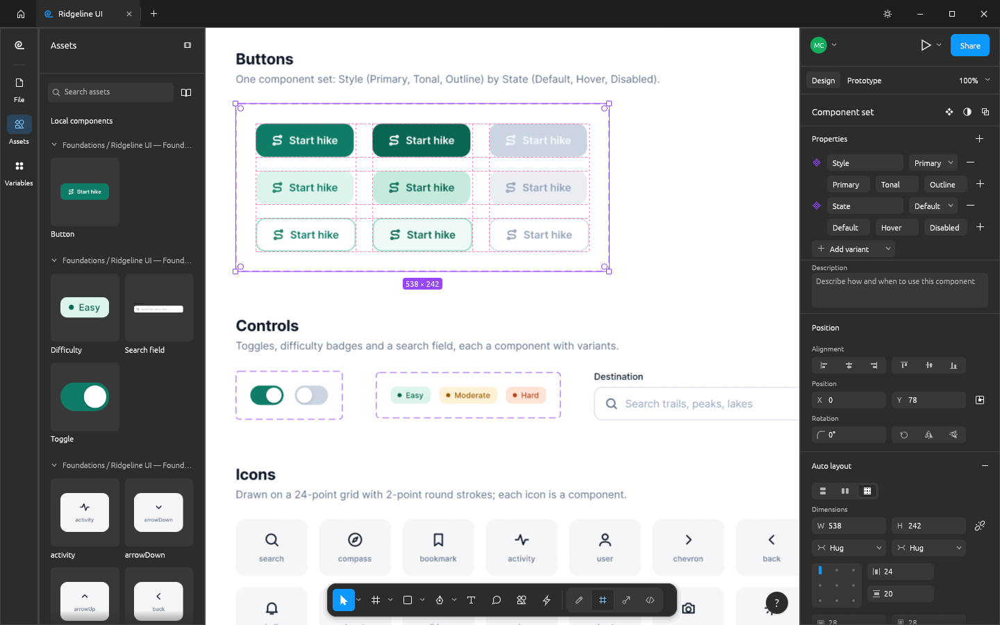
  <p align="center"><sub><b>Components and variants</b>: component sets, variant properties and the Assets panel · <code>official-samples/ridgeline-design-system.figcraft</code></sub></p>
</td>
<td width="50%" valign="top">
  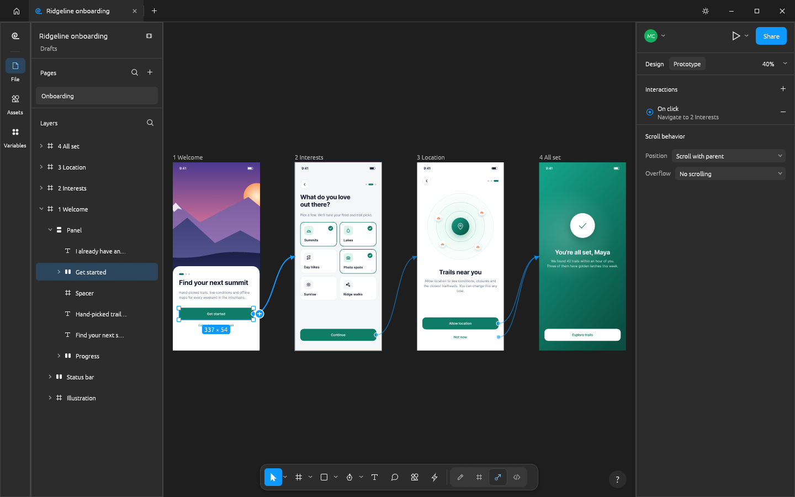
  <p align="center"><sub><b>Prototyping</b>: connections, transitions, back actions and animated flows · <code>official-samples/ridgeline-onboarding.figcraft</code></sub></p>
</td>
</tr>
<tr>
<td width="50%" valign="top">
  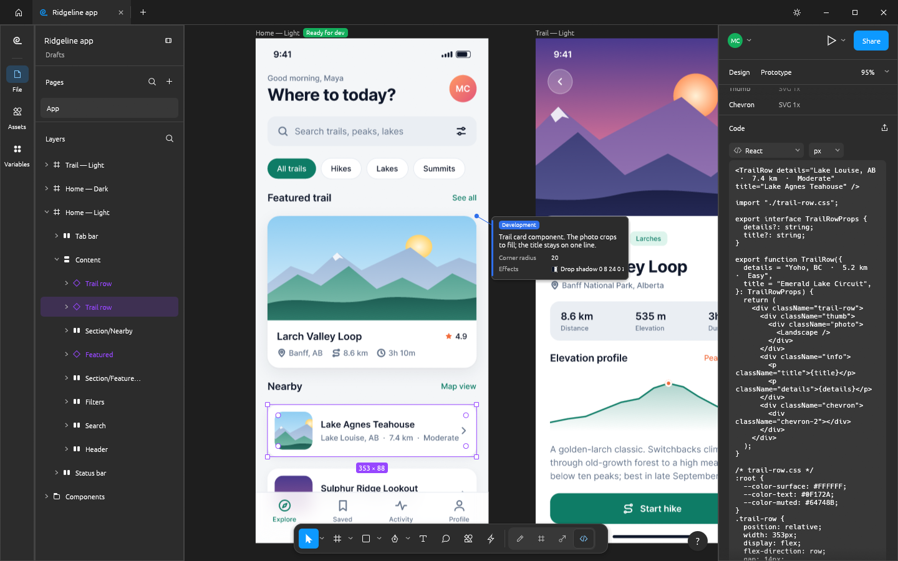
  <p align="center"><sub><b>Dev Mode</b>: ready-for-dev status, annotations and React/CSS code generation · <code>official-samples/ridgeline-app.figcraft</code></sub></p>
</td>
<td width="50%" valign="top">
  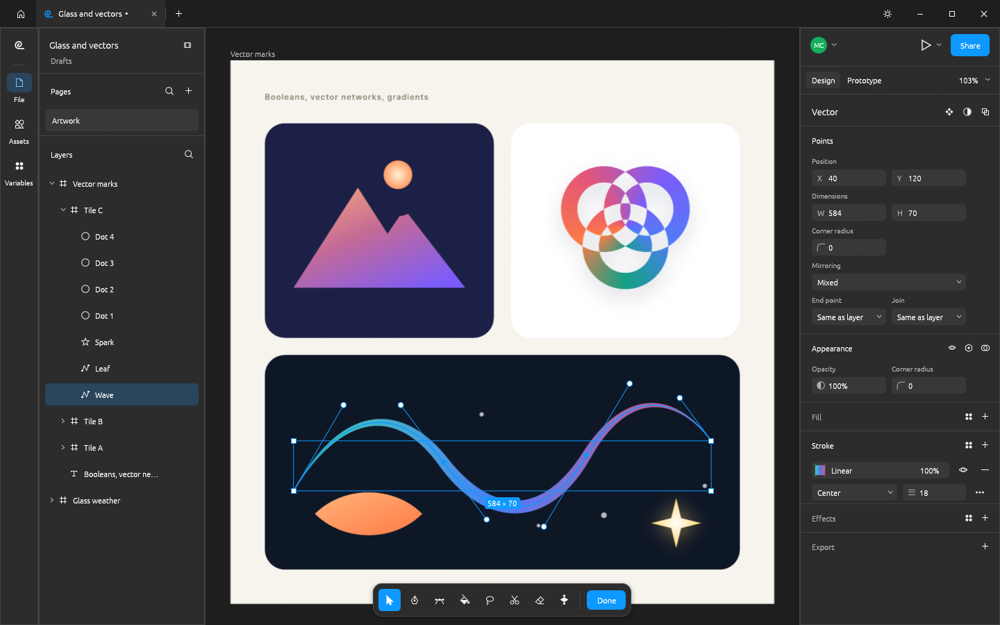
  <p align="center"><sub><b>Vector networks</b>: points and handles, variable-width strokes, booleans that stay editable · <code>official-samples/glass-and-vectors.figcraft</code></sub></p>
</td>
</tr>
<tr>
<td width="50%" valign="top">
  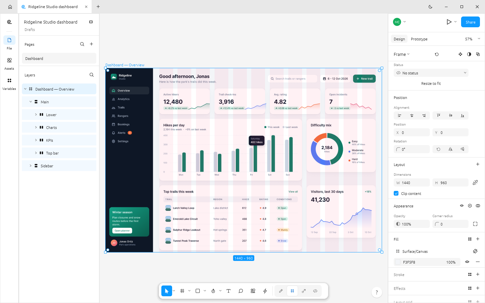
  <p align="center"><sub><b>Layout grids and styles, light theme</b>: 12-column grid, paint, text, effect styles · <code>official-samples/ridgeline-studio-dashboard.figcraft</code></sub></p>
</td>
<td width="50%" valign="top">
  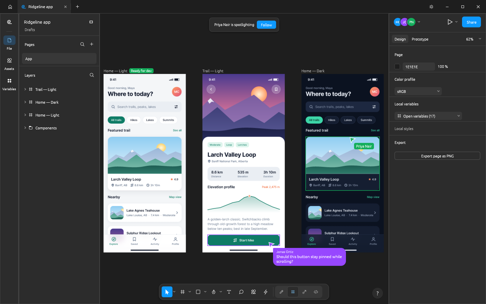
  <p align="center"><sub><b>Live sessions</b>: real-time collaboration with cursor presence, selection outlines, and spotlight banner</sub></p>
</td>
</tr>
<tr>
<td width="50%" valign="top">
  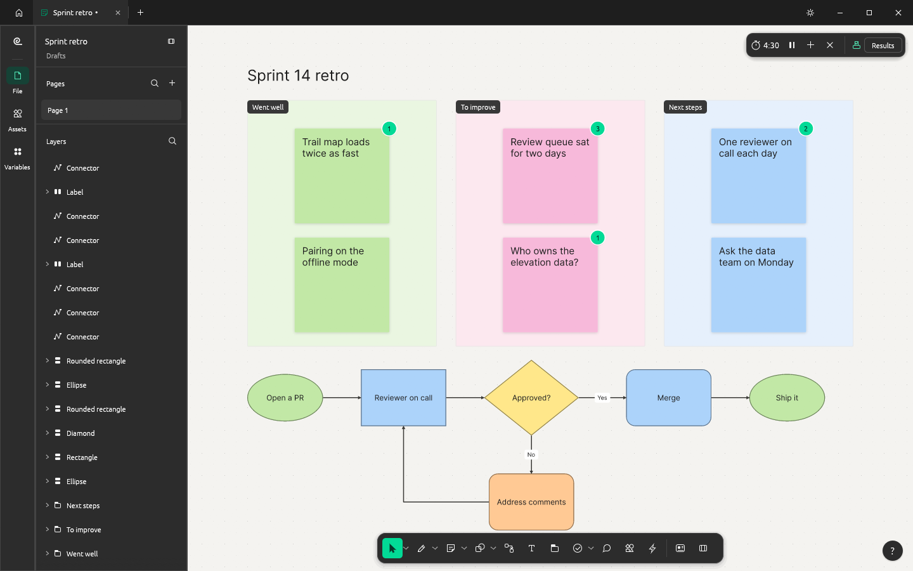
  <p align="center"><sub><b>Boards</b>: whiteboard canvas with sticky notes, templates, connectors, shared timer and voting</sub></p>
</td>
<td width="50%" valign="top">
  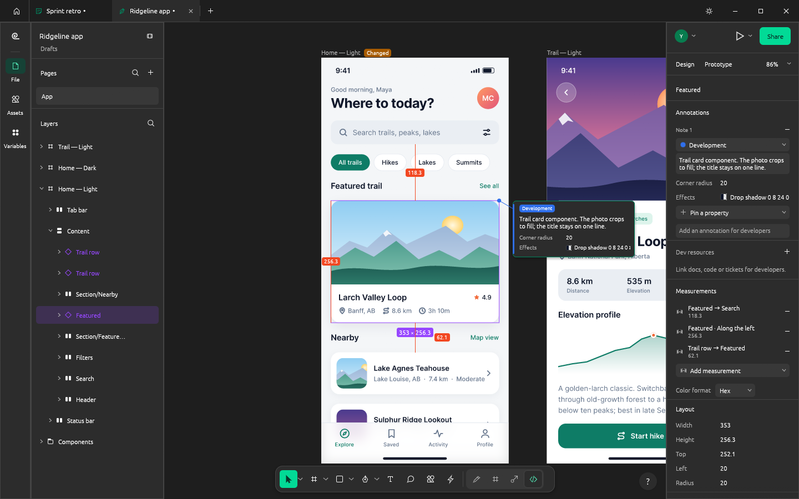
  <p align="center"><sub><b>Dev Mode measurements</b>: redlines placed between layers or along sides, tracking live layers · <code>official-samples/ridgeline-app.figcraft</code></sub></p>
</td>
</tr>
</table>

<br>

## Made in FigCraft

Every design below is rendered with authentic 1:1 fidelity from FigCraft Studio's core engine and official `.figcraft` sample archives:

<table>
<tr>
<td width="33%" valign="top">
  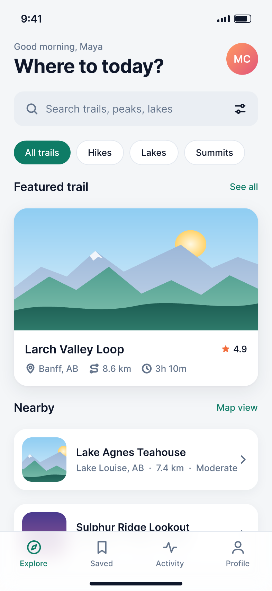
  <p align="center"><sub><b>Home, light</b></sub></p>
</td>
<td width="33%" valign="top">
  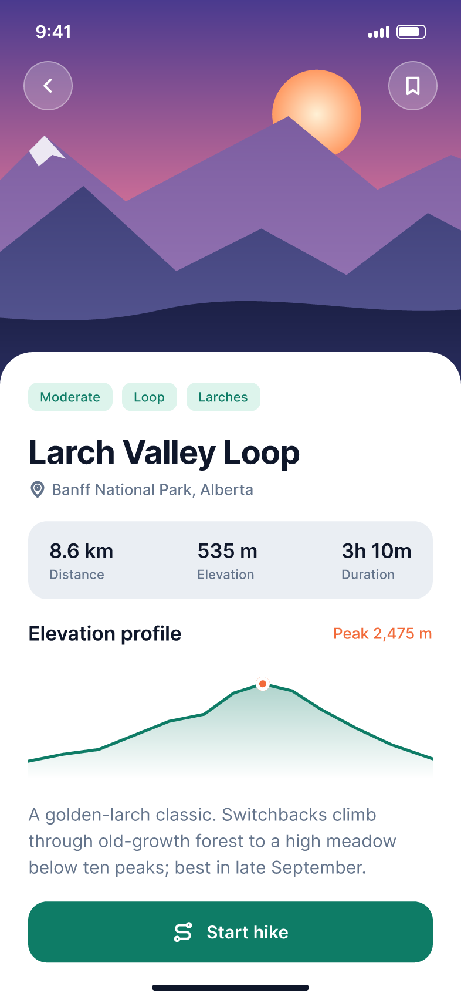
  <p align="center"><sub><b>Trail detail</b></sub></p>
</td>
<td width="33%" valign="top">
  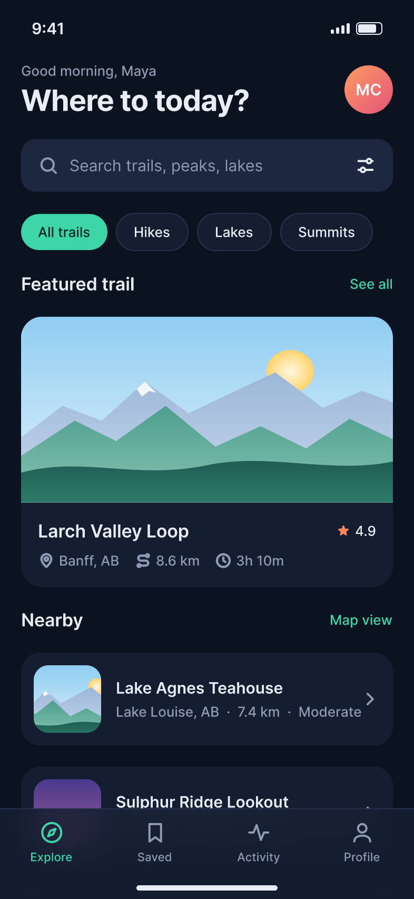
  <p align="center"><sub><b>Home, dark</b>: Dark variable mode</sub></p>
</td>
</tr>
<tr>
<td colspan="3" valign="top">
  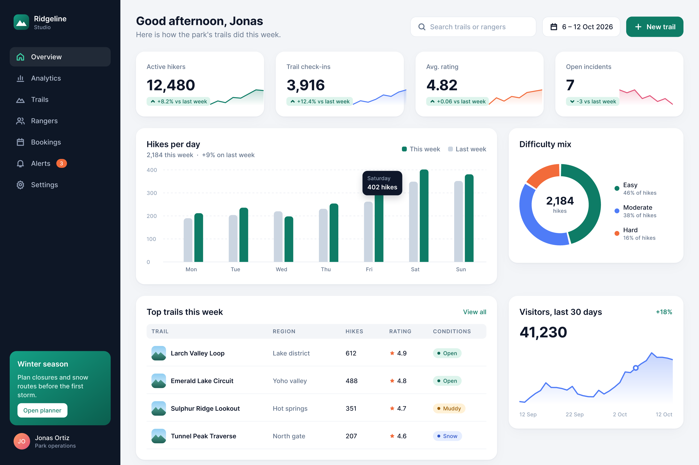
  <p align="center"><sub><b>Ridgeline Studio</b>: desktop dashboard on a 12-column grid, charts drawn from shapes and vectors</sub></p>
</td>
</tr>
<tr>
<td colspan="2" valign="top">
  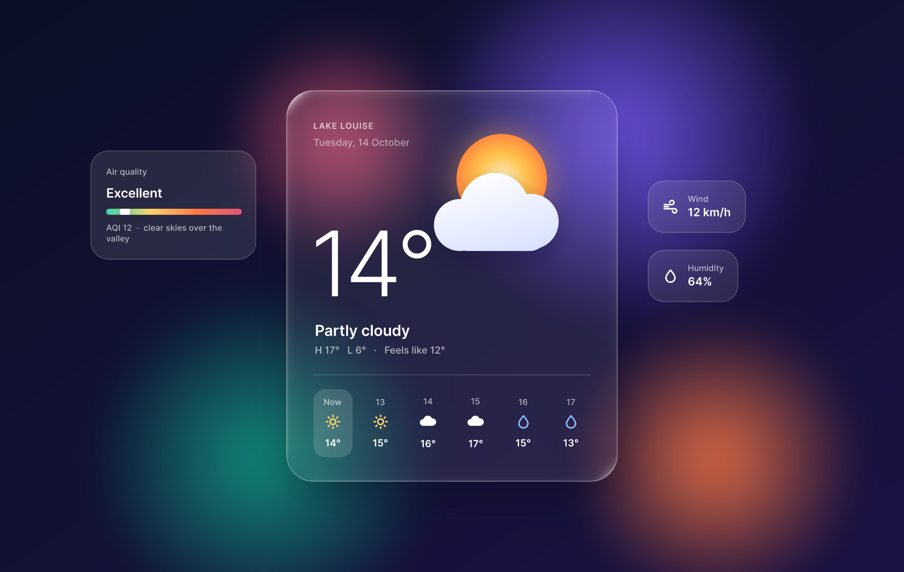
  <p align="center"><sub><b>Glass weather</b>: glass refraction, background blur, and Boolean union cloud paths</sub></p>
</td>
<td width="33%" valign="top">
  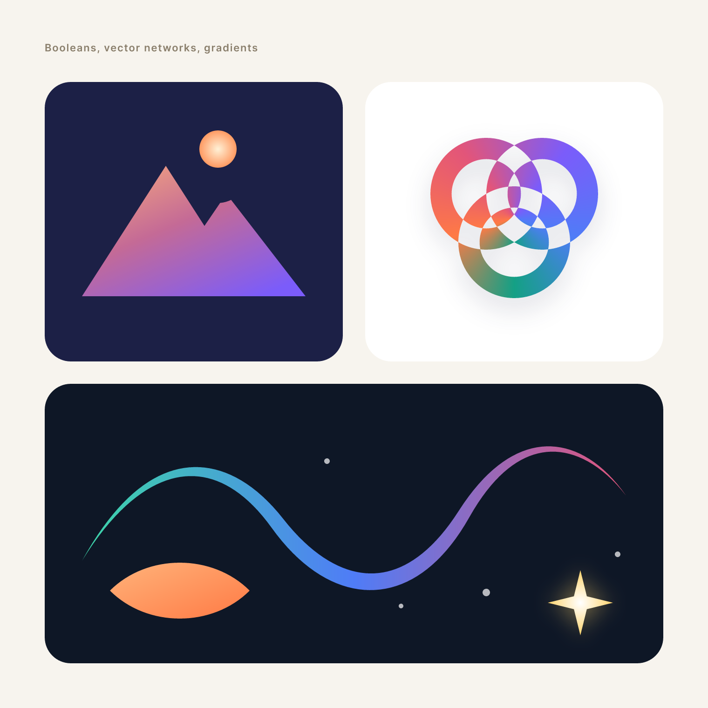
  <p align="center"><sub><b>Vector marks</b>: non-destructive Booleans and variable-width strokes</sub></p>
</td>
</tr>
<tr>
<td colspan="3" valign="top">
  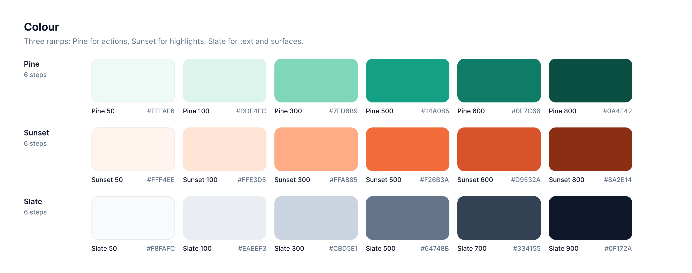
  <p align="center"><sub><b>Ridgeline UI</b>: semantic color ramps where every swatch binds to a paint style</sub></p>
</td>
</tr>
</table>

<br>

## Features

<table>
  <tr>
    <td width="50%" valign="top">
      <h3>Layouts that build themselves</h3>
      Auto layout in horizontal and vertical directions, with flex wrapping, grid tracks, independent padding (top, right, bottom, left), item gaps, text baseline alignment, Hug / Fill / Fixed sizing, min/max dimensions, absolute positioning, on-canvas drag handles for padding and spacing, and arrow key navigation through nested flows.
    </td>
    <td width="50%" valign="top">
      <h3>Components that scale</h3>
      Master components with diamond badges (<code>❖</code>), instances with deep property overrides that survive edits, component sets with multi-dimensional variant matrices (e.g. <code>Style</code>, <code>State</code>), instance swapping, detachment, and an Assets panel with live search and drag-and-drop. Design tokens (color, number, string, boolean) with Light and Dark mode resolution.
    </td>
  </tr>
  <tr>
    <td width="50%" valign="top">
      <h3>Vectors without compromise</h3>
      Real vector networks: Pen and Pencil tools, vector edit mode with path branching, bend tool, paint bucket region fills, lasso, and per-vertex corner rounding. Non-destructive Boolean groups (<b>Union</b>, <b>Subtract</b>, <b>Intersect</b>, <b>Exclude</b>) whose operands remain fully editable on the canvas. Arcs, rings, squircle smooth corners, and variable-width strokes.
    </td>
    <td width="50%" valign="top">
      <h3>Paints and effects</h3>
      Solid fills, linear, radial, angular and diamond gradients with on-canvas transformation handles. Image fills with crop/fit/tile modes. Multiple fills and strokes per layer, every blend mode, precise drop and inner shadows, uniform/progressive layer and background blur, and frosted glass refraction. Color spaces: sRGB and Display P3.
    </td>
  </tr>
  <tr>
    <td width="50%" valign="top">
      <h3>Type that sets beautifully</h3>
      In-place canvas text editing with inline IME composition, mixed styles within paragraphs, auto-width and auto-height bounding boxes, line height, letter spacing, paragraph spacing, text transform, OpenType typographic features, variable font axes, and right-to-left text shaping.
    </td>
    <td width="50%" valign="top">
      <h3>Prototype and hand off</h3>
      Animated prototype connections with glowing blue Bézier curves, trigger interactions (<code>onClick</code>, <code>onHover</code>, <code>onDrag</code>), and Smart Animate transitions. Dev Mode with real-time redline distance measurements, annotation callouts, ready-for-dev tracking, and clean code generation for React, Tailwind CSS, Vanilla CSS, and SwiftUI. Export any layer at 1x, 2x, 3x to PNG, SVG, JPG, WebP, or PDF.
    </td>
  </tr>
</table>

<br>

## Built for agents

FigCraft Studio is built from the ground up to be commanded by autonomous AI coding agents (Claude, Cursor, Antigravity). Every menu item, tool, and canvas gesture maps directly to a unified registry of **400+ commands**:

```sh
# Headless: render artboards to high-resolution PNG
cargo run -p figcraft-cli -- render official-samples/ridgeline-app.figcraft -o dist/app.png --scale 2

# Export vector artboards directly to clean SVG
cargo run -p figcraft-cli -- export official-samples/ridgeline-app.figcraft -o dist/ --format svg

# Run automated batch design modifications via JSON command script
cargo run -p figcraft-cli -- run build-card.json --out card.figcraft

# Query all registered commands and their parameter schemas
cargo run -p figcraft-cli -- commands --filter autoLayout

# Start Model Context Protocol (MCP) server over stdio for AI coding assistants
cargo run -p figcraft-cli -- --mcp
```

### Model Context Protocol (MCP) Configuration

Add FigCraft Studio to your AI assistant configuration:

**Claude Desktop Configuration (`claude_desktop_config.json`):**
```json
{
  "mcpServers": {
    "figcraft": {
      "command": "cargo",
      "args": ["run", "--release", "-p", "figcraft-cli", "--", "--mcp"]
    }
  }
}
```

### Supported MCP Tools
- `figcraft_inspect`: Query node hierarchies, bounds, fills, fonts, and layout properties.
- `figcraft_render`: Render SVG or PNG snapshots of specific frames or components.
- `figcraft_export_code`: Generate React, Tailwind, Vanilla CSS, or SwiftUI code directly from selected nodes.
- `figcraft_modify_node`: Programmatically update layout constraints, fills, text content, and layer hierarchy.

<br>

## 🌐 The FondPeace Creative Ecosystem

FigCraft Studio is proudly developed and maintained as part of the **[FondPeace](https://fondpeace.com/)** open-source initiative. **FondPeace** is a digital platform and creator hub committed to empowering developers, designers, and autonomous agents with high-performance, subscription-free, and privacy-respecting technology.

<table>
  <tr>
    <td width="33%" valign="top">
      <h4>🌟 <a href="https://fondpeace.com/">FondPeace.com</a></h4>
      <b>Digital Innovation & Tech Hub</b><br>
      Discover emerging open-source software, trending developer repositories, AI breakthroughs, and digital productivity frameworks.
    </td>
    <td width="33%" valign="top">
      <h4>⚡ <a href="https://fondpeace.com/">FigCraft Studio</a></h4>
      <b>Native & Offline Interface Design</b><br>
      A clean-room, pure-Rust design suite with 100% local privacy, zero cloud subscription fees, real-time auto-layout, and interactive prototyping.
    </td>
    <td width="33%" valign="top">
      <h4>🤖 <a href="https://fondpeace.com/">AI & Agent Ecosystem</a></h4>
      <b>Model Context Protocol First</b><br>
      Seamless bridge between creative design systems and LLMs (Claude, Cursor, Antigravity) via JSON-RPC 2.0 stdio tooling and headless rendering.
    </td>
  </tr>
</table>

### Why FondPeace Champions Offline-First Open Source
- **100% File Ownership**: Designers and engineers retain complete control over their `.figcraft` archives, design tokens, and components without cloud lock-in.
- **Uncompromised Privacy**: Sensitive enterprise designs never touch external cloud telemetry servers.
- **Instantaneous Native Performance**: Zero web-wrapper overhead, sub-millisecond input response, and low memory consumption powered by pure Rust.

Explore more open-source tools and AI projects at **[fondpeace.com ↗](https://fondpeace.com/)**.

<br>

## 🏛️ Monorepo Workspace Architecture

The FigCraft monorepo is divided into modular, high-cohesion crates and applications:

```
FigCraftStudio/
├── apps/
│   ├── figcraft/             # Native Desktop GUI (eframe + egui + tiny-skia)
│   ├── figcraft-cli/         # Headless CLI exporter & Model Context Protocol (MCP) daemon
│   ├── figcraft-server/      # Real-time WebSocket sync daemon (CRDT delta transport)
│   └── figcraft-web/         # Zero-build browser studio client & WebAssembly target
├── crates/
│   ├── geom/                 # 2D Geometry primitives, Affine transforms, Bézier curves (kurbo)
│   ├── color/                # Color models, sRGB, Display P3, ICC profiles, alpha blend modes
│   ├── layout/               # Directional Auto-Layout flexbox constraint solver (gap, padding, wrap)
│   ├── doc/                  # Persistent immutable scene graph & document state (Arc, imbl)
│   ├── engine/               # Command pattern registry (400+ commands), transaction undo/redo
│   ├── render/               # Multi-core CPU & GPU rasterization pipeline (tiny-skia)
│   ├── format/               # Native .figcraft ZIP archive format reader & serializer
│   ├── ui-egui/              # Native immediate-mode canvas, toolbar, layer tree, inspector
│   ├── mcp/                  # Model Context Protocol server (JSON-RPC 2.0 stdio)
│   └── collab-net/           # Real-time WebSocket sync protocol & cursor presence
├── official-samples/         # Bundled .figcraft archives and unpacked document.json files
├── assets/                   # High-DPI screenshots, icons, and official artwork
├── js/                       # Pure client-side canvas engine & format-reader
├── index.html                # Offline Web Studio interface
├── Cargo.toml                # Workspace manifest
└── Launch_Studio.bat         # Interactive Windows launch menu
```

<br>

## 📱 Official Sample Design Archives

FigCraft Studio comes bundled with 5 official design files extracted from the upstream Storytold design ecosystem, available via the 1-click toolbar switcher:

| Sample Design | Nodes | Description & Visual Assets |
|---|---|---|
| **`ridgeline-app.figcraft`** | **348** | Complete mobile trail explorer: `Home — Light`, `Trail — Light`, `Home — Dark`, mountain vector art, elevation curves, and Master Component sets. |
| **`ridgeline-onboarding.figcraft`** | **142** | 4-screen interactive onboarding flow connected with animated blue Bézier prototype transition curves (`Welcome` ➔ `Interests` ➔ `Location` ➔ `All set`). |
| **`ridgeline-design-system.figcraft`** | **362** | Full design system foundation: typography scale, semantic color ramps, and 1,440pt foundation canvas. |
| **`ridgeline-studio-dashboard.figcraft`** | **268** | Desktop analytics dashboard with 12-column layout grid, KPI metric tiles, and data visualization charts. |
| **`glass-and-vectors.figcraft`** | **97** | Glassmorphic weather cards with background blur and complex Bézier vector marks. |

<br>

## 🚀 Get Started

### Option 1: 1-Click Windows Launcher
Double-click `Launch_Studio.bat` in the project root to open the interactive launcher:

```text
========================================================================
  FIGCRAFT STUDIO ⚡ (Clean-Room Pure Rust Interface Design Suite)
========================================================================

  Select Launch Mode:

  [1] 🦀 Launch Native Desktop Studio (apps/figcraft — Pure Rust + egui)
  [2] 🌐 Launch FigCraft Web Studio (apps/figcraft-web — WebAssembly/HTML5)
  [3] 🤖 Launch FigCraft MCP AI Agent Server (apps/figcraft-cli --mcp)
  [4] ⚡ Launch Multiplayer Collaboration Server (apps/figcraft-server)
  [5] 🛠️ Toolchain Diagnostics & Visual C++ Build Tools Setup
  [0] Exit
```

---

### Option 2: Web Studio (Instant Browser Launch)
Run a lightweight local HTTP server (zero build step needed):

```bash
# Start local server on port 3030
python -m http.server 3030
```
Open **`http://localhost:3030`** in Chrome, Edge, or Firefox.

---

### Option 3: Native Rust Desktop Application
Compile and launch the high-performance desktop executable:

```bash
cargo run --release -p figcraft
```

> **Windows Toolchain Note:** Rust on Windows uses the MSVC linker (`link.exe`). If Microsoft C++ Build Tools are not installed on your system, install them in Administrator PowerShell via:
> ```powershell
> winget install --id Microsoft.VisualStudio.2022.BuildTools --override "--passive --wait --add Microsoft.VisualStudio.Workload.VCTools --includeRecommended"
> ```

---

### Option 4: Headless CLI & MCP Server

```bash
# Display CLI help
cargo run -p figcraft-cli -- --help

# Start Model Context Protocol server over stdio for AI coding assistants:
cargo run -p figcraft-cli -- --mcp

# Export design artboards to high-resolution PNG
cargo run -p figcraft-cli -- export-png official-samples/ridgeline-app.figcraft ./dist 2.0

# Export clean SVG vectors
cargo run -p figcraft-cli -- export-svg official-samples/ridgeline-app.figcraft ./dist
```

---

## 🔒 Privacy and Offline Guarantees

FigCraft Studio is built from day one on **offline-first principles**:
- **Zero Telemetry**: No tracking, analytics, or background telemetry.
- **Zero Accounts**: No sign-in or cloud lock-in. Your files reside exclusively on your local storage.
- **Clean-Room Engineering**: Implemented solely from public specifications and observed behavior. No proprietary code, trade secrets, or unauthorized assets.
- **Local Collaboration**: Peer-to-peer or self-hosted relay via `apps/figcraft-server`. Nothing is routed through third-party servers unless you explicitly configure custom remotes.

---

## 🤝 Community & Contributing

We welcome contributions from designers, Rustaceans, and web engineers!
Please read our [Contributing Guidelines](CONTRIBUTING.md), [Code of Conduct](CODE_OF_CONDUCT.md), and [Security Policy](SECURITY.md) before submitting pull requests.

```bash
# Check formatting and lints
cargo fmt --all -- --check
cargo clippy --workspace --all-targets -- -D warnings
cargo test --workspace
```

---

## 📜 License and Credits

FigCraft Studio is dual-licensed under:
- **MIT License** ([LICENSE-MIT](LICENSE-MIT) or [http://opensource.org/licenses/MIT](http://opensource.org/licenses/MIT))
- **Apache License, Version 2.0** ([LICENSE-APACHE](LICENSE-APACHE) or [http://www.apache.org/licenses/LICENSE-2.0](http://www.apache.org/licenses/LICENSE-2.0))

Required notices and copyright statements are preserved in [NOTICE](NOTICE).

<br>

<p align="center">
  <a href="https://fondpeace.com/" target="_blank" rel="noopener noreferrer">
    
  </a>
  <br><br>
  <br>
  <sub>Crafted with precision for open design freedom. Proudly part of the <a href="https://fondpeace.com/">FondPeace.com</a> ecosystem. ⛰️</sub>
</p>
